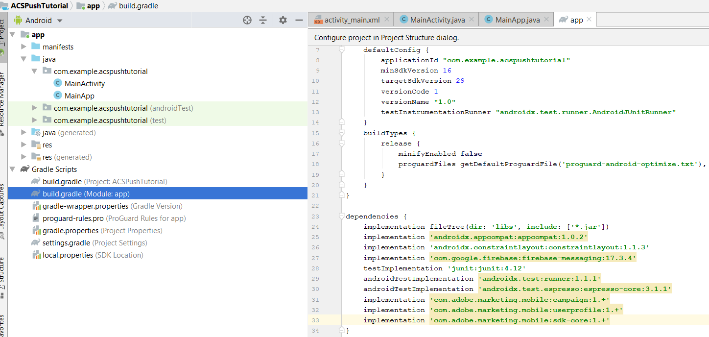

# PASSAGGIO 2 - Integrare [!UICONTROL Mobile SDK] con l&#39;app Android

In questa parte, l&#39;app [!DNL Android] verrà integrata con [!UICONTROL Mobile SDK]. Per integrare [!UICONTROL mobile SDK] con l&#39;app [!DNL Android], eseguire la procedura seguente:

* Apri il progetto *ACSPushTutorial* in [!DNL Android Studio]
* Crea una nuova classe Java denominata *MainApp* che estende [!DNL android.app.Application]
* La struttura del progetto a questo punto dovrebbe essere simile a quella riportata di seguito


* Espandere la cartella [!DNL Gradle Scripts]. Fare doppio clic su [!DNL build.gradle] del modulo. Incollare le dipendenze seguenti nella sezione delle dipendenze del file [!DNL build.gradle]. Il file [!DNL build.gradle] dovrebbe ora essere simile al seguente

<!--
Removed `{.line-numbers}` below
-->

```java
implementation 'com.adobe.marketing.mobile:campaign:1.+'
implementation 'com.adobe.marketing.mobile:userprofile:1.+'
implementation 'com.adobe.marketing.mobile:sdk-core:1.+'
```



* Sincronizza il progetto [!DNL Android] facendo clic sul pulsante Sincronizza ora per sincronizzare il progetto

## Modifica [!DNL AndroidManifest.xml]{#modify-android-manifest}

Apri *AndroidManifest.xml* e incolla le due righe seguenti dopo l&#39;elemento manifesto e prima dell&#39;elemento applicazione. Questo consente all’app di comunicare con il mondo esterno

<!--
Removed `{.line-numbers}` below
-->

```xml
<uses-permission android:name="android.permission.INTERNET" />
<uses-permission android:name="android.permission.ACCESS_NETWORK_STATE" />
```

Copia la riga seguente nell’elemento applicativo
[!DNL android:name=&quot;.MainApp&quot;]
Salva [!DNL AndroidManifest.xml]
[!DNL AndroidManifest.xml] dovrebbe avere questo aspetto

<!--
Removed `{.line-numbers}` below
-->

```xml
<?xml version="1.0" encoding="utf-8"?>
<manifest xmlns:android="http://schemas.android.com/apk/res/android"
    package="com.example.acspushtutorial">
    <uses-permission android:name="android.permission.INTERNET" />
    <uses-permission android:name="android.permission.ACCESS_NETWORK_STATE" />

<application
    android:name=".MainApp"
    android:allowBackup="true"
    android:icon="@mipmap/ic_launcher"
    android:label="@string/app_name"
    android:roundIcon="@mipmap/ic_launcher_round"
    android:supportsRtl="true"
    android:theme="@style/AppTheme">

<activity android:name=".MainActivity">
<intent-filter>
    <action android:name="android.intent.action.MAIN" />
    <category android:name="android.intent.category.LAUNCHER" />
</intent-filter>
</activity>
</application>

</manifest>
```
